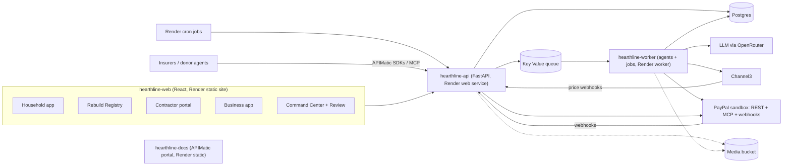

# Hearthline — Build Plan

> Disaster recovery platform for households, donors, contractors, small businesses and relief organizations.
> PayPal AI Hackathon entry · solo build · deadline **Thu Nov 12, 2026, 2:00 pm PT** (target submit: **Wed Nov 11**).

## Decisions log

| Date | Decision |
|---|---|
| Oct 7 | **AI uses free providers through their OpenAI-compatible APIs**: Google Gemini first (`gemini-flash-lite-latest`, about 5 s per photo), then OpenRouter's free models as a fallback. `backend/app/ai.py` is the only file that talks to the model, so providers and models can change without touching agents. |
| Oct 7 | **Budget: free tier for now.** Free OpenRouter models (50 requests a day without credits), Render free plans (no worker or cron services, the API sleeps when idle, free Postgres expires after 30 days). Revisit before the demo video. |
| Oct 7 | **Demo scenario is fictional**: a made-up wildfire in a made-up town, not a real disaster with real victims. |
| Oct 7 | **Renamed from Phoenix to Hearthline.** An unrelated home-service CRM called Hearthline and a contractor-financing company called Hearth exist; judged acceptable for a hackathon entry. |

---

## 1. What Hearthline is

Hearthline supports a family through four stages of a disaster:

| Stage | What happens |
|---|---|
| **Prepare** (before) | The family films a walk through their home. AI lists every item, Channel3 prices them, and Hearthline shows how underinsured they are. Weather alerts warn them when a fire or flood threatens. |
| **Respond** (first weeks) | A **Rebuild Registry** lets donors pay for *specific* items. A Shopper agent buys those items under strict rules, and every dollar is traceable on a public ledger. |
| **Rebuild** (months) | The family exports its insurance claim. Contractors work in milestones held in escrow, and each payment is released only after an AI photo check and human approval. |
| **Reopen** (businesses) | Local shops and restaurants get a **Reopen Fund**: customers pre-buy gift cards to pay for reopening. |

Six product parts sit on one shared core (homes, items, funds, ledger, cases):

1. **Household app** for survivors
2. **Rebuild Registry**, the public donor page
3. **Contractor portal**
4. **Business app** for the Reopen Fund
5. **Command Center** for relief organizations and claim reviewers
6. **Hearthline Public API + MCP server** for insurers and other organizations' AI agents

**Rules that apply everywhere:**
- AI gathers the evidence and makes a recommendation, but **a human approves before any claim-related money moves.**
- Spending rules are enforced in normal code, outside the AI.
- Fire survivors often lose their documents, so **a real victim is never locked out for missing paperwork.** A caseworker can vouch for them instead.

---

## 2. What earns each prize

| Prize | What earns it |
|---|---|
| Grand Prizes | All 5 criteria (below). Ties are broken by Technical Implementation first, so PayPal depth matters most. |
| Most Creative | Turning a phone video into a priced insurance claim, a registry where donors fund specific items, gift-card pre-sales funding a reopening, and an agent that refuses price-gouging sellers |
| Most Impactful | Disaster survivors, underinsurance, and fraud-safe aid, all reviewed by humans |
| Best Demo Delivery | The video goes from one family to a whole community (§13) |
| Best Use of PayPal + AI | 13 PayPal features (§5), 7 agents (§7), and PayPal's own MCP server |
| Best Use of Agentic Commerce | The Shopper agent pays on its own using a saved PayPal payment method, within code-enforced rules. Outside donor agents can find and pay for needs through the Hearthline MCP server. |
| AG Grid | 5 grids using Enterprise features plus the AI Toolkit (§6) |
| Bryntum | 4 Bryntum products, all backed by our own database (§6) |
| Channel3 | Search, image search, find products in an image, product details, price history and price tracking (§6) |
| APIMatic | The PayPal plugin used during development, plus SDKs and a docs site for our own API, which our frontend also uses (§6) |
| Render | The full deployment file: web and static services, Postgres, a Key Value store, and a one-click deploy button. Worker and cron services are added if we move off the free tier (§6). |

Reminder: one project can win at most **2 prizes** (a Grand Prize or one Honorable Mention, plus one Sponsor Prize).

---

## 3. Tech stack

| Layer | Choice | Why |
|---|---|---|
| Backend | **Python 3.12, FastAPI**, SQLAlchemy and Alembic, `uv`, `ruff`, `pytest` | You prefer Python. FastAPI generates an OpenAPI spec automatically, which APIMatic needs. |
| Jobs | `arq` (an async Redis job queue) on Render Key Value | AI and PayPal jobs that take a while run in the background. On the free tier they run inside the API process; a separate worker is a plan change later. |
| Database | Postgres (Render **free tier** for now) | Free Postgres is deleted 30 days after creation and judging runs until Dec 15, so create it late or upgrade before judging |
| Media | An S3-compatible bucket (Cloudflare R2 free tier) | Render's disks attach to only one service |
| Frontend | **React + TypeScript + Vite**, TanStack Query, react-i18next, Tailwind | AG Grid and Bryntum are JavaScript components. The frontend stays thin and the logic lives in Python. |
| AI | **Google Gemini free tier, then OpenRouter free models**, all through OpenAI-compatible APIs with the `openai` Python SDK. `AI_MODELS` is a `provider:model` fallback list | Free. Structured output uses a forced `submit` tool call, which works on any tool-capable model. |
| PayPal | `paypal-server-sdk` (Orders, Payments, Vault), PayPal's **sandbox MCP server** (SSE at `https://mcp.sandbox.paypal.com/sse`, 46 tools) used through the Python `mcp` client, a small `httpx` client for Payouts, and the PayPal JS SDK v6 in the browser | Payouts isn't in the Server SDK or the Agent Toolkit, so it gets its own client |
| Products | `channel3-sdk` (Python) | |
| Geo | `shapely`, the US Census Geocoder (free, no key), GeoJSON disaster boundaries | |
| Trust | `imagehash` (perceptual image hashes), Pillow (photo metadata), ProPublica Nonprofit Explorer API | |
| Voice | The browser's Web Speech API turns speech into text, and the text goes to the AI | Free, and works in Chrome and Edge |

**AI usage notes:**
- Agents run a tool-calling loop in our own code. Every tool call passes through the rules engine and approval checks before it runs.
- Extraction tasks (items, receipts, insurance policies) use `ai.parse()`, which returns validated Pydantic models.
- **Save AI requests**: free models allow 50 requests a day and are often rate-limited upstream. Store every AI result in the database and never recompute it. The demo data is generated once and saved.
- **When the AI is unavailable**, Channel3's find-products-in-image still produces an inventory (up to 6 items per photo), and the household can add items by hand.

---

## 4. Architecture



**How money moves.** The AI suggests an action. The **rules engine** checks it against limits, allowed categories, the verified address, and the ban on adding new people to pay. A **human approval** is added where required. Only then does the PayPal call run. Every step writes to an **audit log that can't be edited** (each entry is chained to the previous one by hash) and to a **double-entry ledger**.

---

## 5. PayPal features we use (13)

| # | PayPal feature | Hearthline feature | Library |
|---|---|---|---|
| 1 | **Orders v2** | Registry donations, Reopen gift cards, Shopper purchases | `paypal-server-sdk` |
| 2 | **Payments v2** (capture, refund) | Captures, plus donor refunds when a fraud case is rejected | `paypal-server-sdk` |
| 3 | **Vault v3** | A saved PayPal payment method for the recovery fund, so the Shopper can pay on its own | `paypal-server-sdk` |
| 4 | **Payouts** (single and batch) | Batch cash aid, contractor milestones, volunteer reimbursements | `httpx` client |
| 5 | **Subscriptions** | Paid Prepare plan, monthly "adopt a family" donors, Reopen regulars | MCP tools |
| 6 | **Invoicing** | Contractors invoice homeowners, plus large Reopen pre-orders | MCP tools |
| 7 | **Disputes** | Mediation between homeowners and contractors | MCP tools + REST |
| 8 | **Shipment tracking** | Delivery proof for each purchase, shown on the donor's timeline | MCP tools |
| 9 | **Transaction Search / Reporting** | Nightly check that our ledger matches PayPal, plus Sentinel signals | MCP tools |
| 10 | **Webhooks** (with signature verification) | Drive every status change | REST |
| 11 | **JS SDK v6**: PayPal, **Venmo**, **Pay Later** buttons | Registry and Reopen checkout | Browser |
| 12 | **Log in with PayPal** | Links a household's or contractor's own PayPal account. It provides the consent step for registries started by friends, and makes that account the verified payee. | REST |
| 13 | **PayPal MCP server** (Agent Toolkit tools) | The agents' PayPal tools, every call routed through our rules engine | `mcp` client |

**Sandbox accounts needed:**
- a platform business account (Hearthline)
- a "retailer" business account (stands in for the stores Channel3 finds)
- a contractor business account
- 3 personal accounts (household, donor, volunteer)

**Being honest about purchases.** Channel3 finds real products, but in the sandbox the payment goes to the stand-in retailer account. The README must say this. In production it would go through the retailer's checkout or an agentic checkout protocol.

---

## 6. Sponsor tools: full use

### AG Grid (Enterprise + AG Charts)
| Grid | Features used |
|---|---|
| Household inventory | Rows grouped by room, value totals, inline editing, image cells, evidence-level badges, **Excel export** of the insurance claim |
| Money ledger | Expandable rows (transaction → evidence), pivot by funding source, built-in charts |
| Command Center households | **Server-side loading** for 2,000+ seeded households, set filters, sparklines, cells that flash on live updates |
| Review queue | Sorting by risk, how long a case has waited and amount; row selection for batch payouts; a status bar summing the selected dollars |
| Price-gouging report | Price-history sparklines, conditional formatting |
| **"Ask the grid"** | The **AI Toolkit** (`getStructuredSchema()`) plus the LLM's structured output, so you can type requests like "households in the fire zone with unmet needs over $5k, grouped by street" |

### Bryntum (4 products)
| Product | Use |
|---|---|
| **Gantt** | Each home's rebuild plan, with milestones linked to escrow payments. Also each business's reopening plan. |
| **Scheduler Pro** | Volunteer crews, deliveries and contractor jobs across the disaster area |
| **Calendar** | Video-verification calls, adjuster visits, claim deadlines |
| **TaskBoard** | Case pipeline: Submitted → In review → Approved → Funded → Delivered |

All four save to our Postgres database. FastAPI implements Bryntum's **CrudManager load/sync protocol**.

### Channel3
| Endpoint | Use |
|---|---|
| Find products in image | Turns a room photo into a list of products. This is the core of Prepare. |
| Image search | Matches a cropped item to a product |
| Text search | Finds products from text descriptions and voice input |
| Product detail and offers | Replacement value, plus what the Shopper buys |
| Price history | Pre-disaster baseline, used to detect price gouging |
| Price tracking + webhooks | Live price-gouging guard |

### APIMatic
1. **PayPal Context Plugin** (`npx context-plugins install paypal`), used in Claude Code throughout development. The README explains how.
2. **Hearthline Public API**: FastAPI produces the OpenAPI spec, and APIMatic **checks and lints** it.
3. **Generated SDKs** in Python, TypeScript, Java, C# and Go. **Our own frontend uses the generated TypeScript SDK** for public endpoints, and the donor-agent demo uses the Python SDK.
4. **A docs site generated by APIMatic**, hosted as a Render static site.
5. A **GitHub Action** regenerates the SDKs and docs whenever the spec changes.

### Render (`render.yaml` deployment file)
| Service | Type |
|---|---|
| `hearthline-api` | Web service (also receives PayPal and Channel3 webhooks) |
| `hearthline-web` | Static site |
| `hearthline-docs` | Static site (APIMatic portal) |
| `hearthline-worker` | Background worker (agents, video processing, batch payouts) |
| `cron-alerts` | Every 10 minutes: poll National Weather Service alerts |
| `cron-prices` | Hourly: refresh Channel3 prices and check for gouging |
| `cron-sentinel` | Hourly: fraud sweep |
| `cron-reminders` | Daily: claim-deadline reminders |
| `cron-reconcile` | Nightly: check our ledger against PayPal Transaction Search |
| `hearthline-db` | Postgres |
| `hearthline-kv` | Key Value store (job queue and cache) |

The file also defines shared groups of environment variables for secrets, uses private networking, health checks and preview environments, and includes a **"Deploy to Render" button in the README** so judges can deploy everything with one click.

**Cost estimate:** about $25–40 per month from October through December (paid Postgres, worker and web instances, cron jobs).

### Free extras (no prize, almost no work)
A Postman collection exported from the OpenAPI spec, to make judges' testing easier.

---

## 7. AI agents (7)

| Agent | Job | Tools | What limits it |
|---|---|---|---|
| **Inventory** | Turns photos and video frames into a list of items: name, room, quantity, condition, evidence level | Vision LLM, Channel3 find-in-image | The user confirms or edits every item |
| **Valuation** | Finds the replacement price for each item | Channel3 search, image search, product detail, price history | Outliers need extra proof |
| **Policy** | Reads the insurance policy PDF: coverage limits, sub-limits, deadlines | PDF text extraction, then the LLM with structured output | Read-only |
| **Shopper** | Buys funded registry items and essentials | Channel3, PayPal order paid with the saved payment method, shipment tracking | **The rules engine**: per-item and per-day limits, allowed categories, verified address only, no new payees, approval above a threshold, gouging check |
| **Funds** | Routes donations, maintains the ledger, writes impact reports | Ledger, PayPal Transaction Search | Can't move money; it only proposes |
| **Site** | Checks contractor milestone photos against the phase description | Vision LLM, photo metadata and location check | Homeowner approval, plus human review for large amounts |
| **Sentinel** | Flags possible fraud and explains each flag in plain English | Image hashes, duplicate-account graph, address checks, price outliers | **Never decides.** It only routes cases to human review. |

Households chat with these agents in their own language, by typing or by voice.

---

## 8. Trust and human review (summary)

**Verification levels:**

| Level | Requirement | What it unlocks |
|---|---|---|
| 0 | Unverified | Can set up a profile, can't receive money |
| 1 | Address inside the disaster zone, plus a linked PayPal account | Can receive **items** shipped to the verified address |
| 2 | Proof of residence, **or** a caseworker vouching for them | Can receive cash aid, with higher limits |
| 3 | A Prepare scan from before the disaster | Gets a "verified inventory" badge, and the claim is marked high-confidence |

**Review depth by risk:**

| Risk | Review |
|---|---|
| Low | 1 reviewer |
| Medium | 1 reviewer **plus a live video call** (booked in Bryntum Calendar) |
| High (flags, large amounts or cash) | **2 independent reviewers.** A supervisor decides if they disagree. |
| Random check | 5% of approved cases are re-reviewed |

**Keeping reviewers honest:**
- Reviewers verify their identity.
- Cases are assigned at random.
- No reviewer gets cases from their own area or people they're connected to.
- Every rejection needs a reason.
- Reviewers with unusual approval rates are flagged.
- Batch payouts need two people to approve them.

**Fair to households:**
- Households see their case status live.
- "Ask for more evidence" is the default instead of rejection.
- Appeals go to a different reviewer.
- If a case is rejected, donors are refunded automatically.

**Stopping specific scams:**
- duplicate photos (image hashes)
- photo metadata checks
- Channel3 price limits
- registry consent through Log in with PayPal
- contractor deposit caps (California: 10% or $1,000, whichever is less)
- license and nonprofit checks

---

## 9. Core data model

`users` (role: household, donor, contractor, reviewer, supervisor, org_admin, business) · `organizations` · `disaster_events` (type, GeoJSON zone, declared_at) · `households` · `verifications` · `rooms` · `items` (ai_value, user_value, approved_value, evidence_level, status) · `media` (sha256, phash, exif, captured_at) · `registries` · `registry_items` · `donations` · `purchases` (channel3_product_id, price, policy_decision, tracking) · `ledger_accounts` · `ledger_entries` · `cases` · `case_reviews` · `audit_log` (entries chained by hash) · `contractors` · `projects` · `milestones` · `payouts` · `businesses` · `reopen_campaigns` · `gift_cards` · `price_snapshots` · `gouging_flags` · `alerts` · `volunteer_shifts` · `appointments`

---

## 10. Repo layout

```
hearthline/
  backend/
    app/
      api/          # FastAPI routers (public API kept separate under /v1)
      agents/       # 7 agents + Tool Runner hooks
      policy/       # rules engine (spending limits, approvals)
      paypal/       # server-sdk wrapper, MCP client, payouts, webhooks
      channel3/
      trust/        # verification levels, image hashes, metadata, Sentinel rules
      review/       # cases, assignment, two-person rule
      ledger/
      geo/          # disaster zones, geocoding, NWS alerts
      bryntum/      # CrudManager load/sync endpoints
      mcp_server/   # Hearthline MCP server
    worker.py
    cron/
    tests/
  frontend/
    src/{household,registry,contractor,business,command,review,shared}
    src/sdk/        # APIMatic-generated TypeScript SDK
  sdks/             # APIMatic-generated SDKs (Python, Java, C#, Go)
  seed/             # demo wildfire scenario, 2,000 synthetic households
  render.yaml
  LICENSE           # MIT
  README.md
  PLAN.md
```

---

## 11. Week-by-week plan

### Week 0: Sat Oct 3 – Mon Oct 5: setup and test runs
- [ ] Create accounts and keys:
  - [ ] PayPal sandbox app and 6 sandbox accounts (§5); turn on Vault, Payouts and Log in with PayPal
  - [ ] Anthropic
  - [ ] Channel3
  - [ ] Render
  - [ ] R2 bucket
  - [ ] APIMatic
- [ ] **Ask on the PayPal Discord** about hackathon licenses for AG Grid Enterprise and Bryntum, and about APIMatic access
- [ ] Install the APIMatic PayPal Context Plugin in Claude Code
- [ ] Create the GitHub repo with an MIT `LICENSE` and the skeleton above. Deploy a hello-world through `render.yaml`.
- [ ] **Test runs (each one decides a design choice):**
  1. Vision LLM plus Channel3 find-products-in-image on real room photos. Is it accurate enough?
  2. PayPal: save a payment method, then run an **agent-initiated order** with it in the sandbox
  3. PayPal: a sandbox **batch payout** to 3 recipients
  4. Connect to PayPal's sandbox MCP server from Python and list its tools
  5. Disputes in the sandbox: open a dispute as the buyer, then move it to a decision through the API
  6. PayPal delayed payouts (holding money) for escrow. If too complex, Hearthline holds the funds itself.

### Week 1: Tue Oct 6 – Sun Oct 11: Prepare and inventory
*(Oct 6, 9 am PT: "Start building with PayPal" webinar. Oct 7: APIMatic webinar.)*
- [x] Auth, roles, **one-click demo personas** for judges (plus `/login?as=…&next=…` deep links), and i18n from day one (5 languages)
- [x] Disaster zones that work for any disaster type (GeoJSON), geocoding, the inside-the-zone check, and the fictional Sablewood Fire boundary
- [x] Upload photos or video; video frames are extracted **in the browser**; a background task runs the Inventory agent (one AI call per scan), then the Valuation agent (parallel Channel3, median pricing)
- [x] AG Grid household inventory: grouped by room, editable, right-click menu, Excel claim export
- [x] Underinsurance warning; NWS alerts fetched on demand (no cron on the free tier), plus a "simulate alert" button for the demo
- **Done when:** a video of a room produces a priced inventory you can edit and export. **Done Oct 7** (ahead of schedule).

### Week 2: Mon Oct 12 – Sun Oct 18: money core
*(Oct 12: "payments dashboard" webinar.)*
- [x] Double-entry ledger, PayPal webhooks with signature verification, the hash-chained audit log
- [x] Rebuild Registry page: **PayPal, Venmo and Pay Later** buttons (JS SDK v6, verified rendering and opening sandbox checkout); donations fund specific items. *Pending: registry consent through Log in with PayPal (needs the return URL set in the PayPal app); a completed capture needs a personal sandbox buyer account.*
- [x] Shopper agent with the **rules engine** (8 rules, approval over $300), paying the retailer with **Payouts** (live-verified), simulated shipment tracking, the donor feed. *Pending: paying with the saved PayPal method (spike 2 needs a personal sandbox buyer account).*
- [x] AG Grid ledger: expandable rows (debits/credits), grouping, side panel with pivot, built-in charts, Excel export
- [ ] Set up the APIMatic pipeline: spec check, then TypeScript SDK generation, then the GitHub Action
- **Done when:** a donor funds a bed with Venmo, the agent buys it, the tracking number shows up, and the ledger balances.

### Week 3: Oct 19 – Oct 25: trust and human review (**done Oct 8**)
- [x] Verification levels 0–3, caseworker vouching, image-hash duplicate checks (the later uploader is flagged; the original family only gets a notice), photo metadata checks, price limits
- [x] Sentinel rules plus AI-written summaries and questions (falls back to rule messages without AI)
- [x] Review queue (AG Grid) and case view (in-zone check, evidence photos, flags, Sentinel, household facts)
- [x] Approve, ask for evidence, or reject; PayPal pays cash aid (Payouts) or refunds donors of a rejected registry; cash aid needs level 2
- [x] Two-person rule for high risk / large amounts, supervisor on disagreement, random assignment, conflict-of-interest checks, 5% random audits
- [x] Bryntum **Calendar** (video-call booking, CrudManager load/sync) and **TaskBoard** (case pipeline)
- [x] Household Aid page: verification level, cash-aid requests, replies to reviewer questions
- **Done when:** the scam-clone scenario is caught, rejected and refunded, and a real claim is approved and paid out. **Both verified in the browser (e2e/review_scam.py, e2e/cash_aid.py).**

### Week 4: Oct 26 – Nov 1: Rebuild and Command Center → **core feature-complete**
- [x] Contractor portal, Bryntum **Gantt** with milestones tied to escrow, deposit cap, Site agent photo check, Payouts, Disputes flow
  - Stage 1 (backend): projects, plans with the California deposit cap, escrow in the ledger, milestone submission with the Site agent and photo-date checks, auto-pay only for clean milestones up to $10,000, everything else and every dispute goes to human review.
  - Stage 2: household `/rebuild` page (invite a verified contractor, accept the plan into escrow, approve or dispute each milestone with its photos and photo check) and contractor `/contractor` portal (plan editor with a live deposit-cap check, submit work in order). Bryntum Gantt over CrudManager load/sync: read-only for the family; the contractor can drag milestones that haven't been submitted, and the server re-checks that. Reviewers see the milestone, photos and photo check on the case. Photo-check results are Sentinel flags, so a mismatch makes the case high risk with two reviewers. Start-up seed: a $60,000 insurance advance, the Rivera rebuild with Okafor Builders (deposit paid, demolition waiting for approval) and a Haddad project waiting for a plan.
  - **Sandbox limit found:** the hackathon app's sandbox business account can't cover a $6,000 payout (`INSUFFICIENT_FUNDS`). The app now says so plainly and nothing moves. The account needs a larger balance before the demo.
- [ ] Command Center: 2,000 seeded households (server-side AG Grid), **batch cash aid via Payouts** with two-person approval, Bryntum **Scheduler Pro** for crews and deliveries, "Ask the grid" (AI Toolkit)
- [ ] **Nov 1: record a rough version of the video.** This is the fallback if week 5 goes badly.
- **Done when:** the whole household story works end to end on the Render deployment.

### Week 5: Nov 2 – Nov 8: additions, API and polish
- [ ] **Reopen Fund**:
  - business verification
  - gift-card pre-sales (Orders, Venmo, Pay Later)
  - Subscriptions for regulars
  - tranches released along a reopening Gantt
  - QR-code redemption
  - automatic refunds if the business doesn't reopen
- [ ] **Price-gouging guard**: Channel3 price history and tracking webhooks; the Shopper refuses gouging sellers; a public report grid
- [ ] AI impact reports (donor timelines and an organization grant-report PDF)
- [ ] Voice input (Web Speech API)
- [ ] Policy agent (insurance PDF)
- [ ] Hearthline Public API v1, SDKs in all languages, the docs site on Render, the **Hearthline MCP server**, a donor-agent demo script, a Postman collection

### Week 6: Mon Nov 9 – Thu Nov 12: freeze and ship
- [ ] **Mon Nov 9: feature freeze.** Only bug fixes and polish after this.
- [ ] Final demo data (wildfire scenario), UI polish, empty states, a pass through every language
- [ ] README: what Hearthline is, one-click Render deploy, local setup, **sandbox login details**, demo personas, which sponsor tools are used where, the sandbox limit on purchases, "how we built it" (APIMatic plugin)
- [ ] Record the final video (§13): **under 3:00**, public on YouTube, no copyrighted music
- [ ] Devpost write-up. **Submit Wed Nov 11.** Nov 12 is the safety buffer.

---

## 12. Cut list (if behind, cut in this order)

1. Policy agent (insurance PDF)
2. Voice input (keep typed input in multiple languages)
3. Hearthline MCP server and the agent-to-agent demo (keep the public API and SDKs)
4. Disputes flow
5. Contractor license and nonprofit checks (reviewers check them by hand instead)
6. Organization grant-report PDF (keep donor timelines)

**Never cut:**
- Prepare → inventory → prices
- Registry + PayPal/Venmo
- Shopper + rules engine
- Human review → payout or refund
- Contractor milestone payout
- Command Center batch cash aid
- Reopen Fund
- Price-gouging guard
- Render deployment file
- APIMatic SDKs

**Later, if time allows (Group B):** a duplicate-aid tracker and an aid fairness dashboard.
**Decide after the core is done (Group C, pitch-only):** bridge funding until insurance pays, insurers paying claims through PayPal, diaspora support, offline mode, corporate matching, buying from local businesses first, a tax worksheet.

---

## 13. Video outline (draft, under 3:00)

| Time | Scene |
|---|---|
| 0:00–0:15 | Hook: the problem, and the family we'll follow |
| 0:15–0:40 | **Prepare**: scan the home → priced inventory in AG Grid → "underinsured by $62k" → wildfire alert arrives |
| 0:40–1:10 | **Respond**: Registry → donor pays with Venmo → Shopper buys within its rules and refuses a gouging seller → tracking appears |
| 1:10–1:30 | **Scam attempt**: cloned registry caught → reviewer rejects → donors refunded |
| 1:30–1:55 | **Human review**: AI evidence packet → reviewer approves → PayPal payout arrives |
| 1:55–2:15 | **Rebuild**: Gantt → contractor's photo passes the AI check → milestone paid |
| 2:15–2:35 | **Reopen**: the corner bakery's gift cards sell out, and the bakery reopens |
| 2:35–2:55 | **Zoom out**: Command Center, 2,000 households, batch cash aid, "Ask the grid" |
| 2:55–3:00 | Close |

---

## 14. Risks

| Risk | Plan |
|---|---|
| AG Grid Enterprise and Bryntum are commercial (Bryntum's trial lasts 45 days, but judging runs to Dec 15) | Ask on Discord in week 0. Trials show watermarks but still work, so development isn't blocked. |
| AI vision accuracy | Test run in week 0. A human confirms every item anyway. |
| Agent-initiated payments or escrow are hard in the sandbox | Test runs in week 0. Fallback: Hearthline holds the funds itself and pays out with Payouts. |
| Purchases are simulated in the sandbox | Say so plainly in the README and the Devpost write-up |
| Too much scope for one person | Feature-complete core by Nov 1, follow the cut list, freeze on Nov 9 |
| Render's free database is deleted after 30 days | Use the paid Postgres tier from the start |
| Secrets leaking into the public repo | `.env` stays out of git; Render keeps secrets with `sync: false`; scan for secrets before every push |

---

## 15. Devpost checklist
- [ ] Public GitHub repo with an **MIT LICENSE** that shows in the About sidebar
- [ ] All commits dated after Oct 1, 2026
- [ ] README with setup steps **and** the hosted URL, sandbox login details, demo personas
- [ ] Hosted demo stays up until **Dec 15**
- [ ] Public YouTube video under 3:00, showing the app running, with no copyrighted music
- [ ] English text description: features, sponsor tool usage, honest limitations
