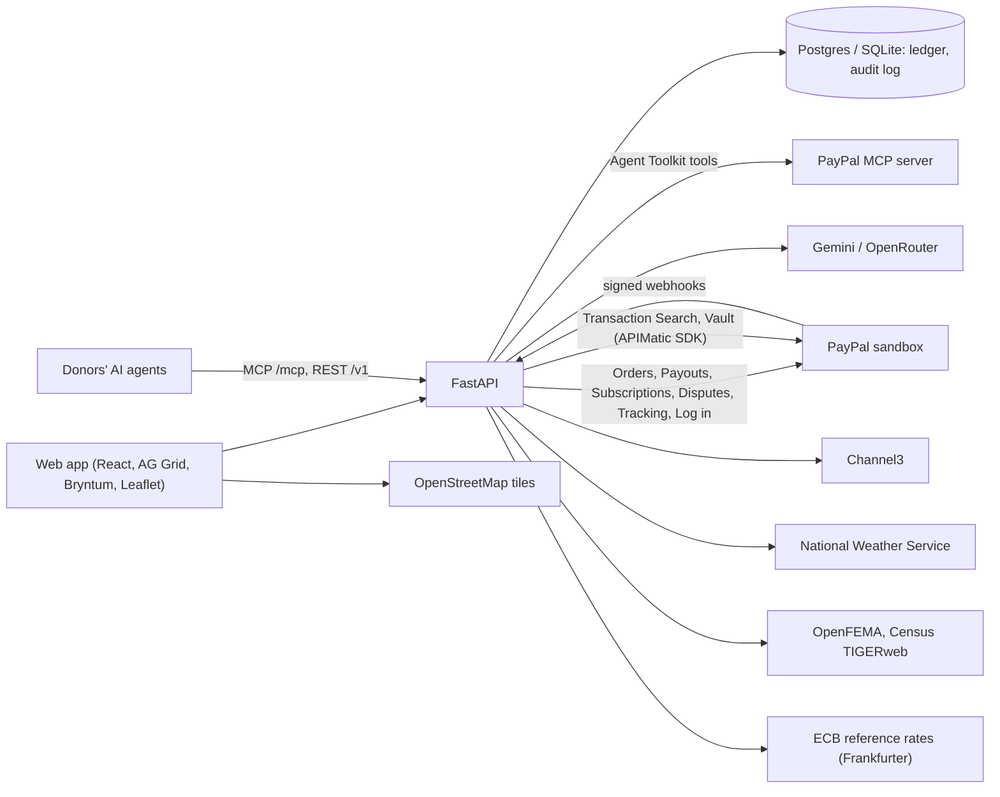

# Hearthline

[](https://github.com/AnshulPatil2005/hearthline/actions/workflows/ci.yml)

**Disaster recovery for the people who live through it.** Hearthline helps a family document their home *before* a
disaster, get help that can't be stolen or diverted *during* it, rebuild with contractors who are paid only for
verified work, and helps the local businesses they depend on reopen with support from their regulars.

Built for the [PayPal AI Hackathon](https://paypalaihackathon.devpost.com) on the PayPal sandbox, with Google Gemini,
AG Grid, Bryntum, Channel3, APIMatic and Render.

- **Video:** _link added at submission_
- **Live demo:** https://hearthline-web.onrender.com (Render's free plan sleeps when idle, so the first visit can take
  about a minute; the page says when it's waking up)
- **Feature guide for judges:** https://hearthline-web.onrender.com/features lists all 27 features, each opening
  signed in as the right person, and how each sponsor's tool is used, with a link to every place it's used
- **The demo is fictional.** Sablewood, its wildfire and its people are made up. Every payment runs in the PayPal
  sandbox, so no real money moves.
- **Security:** [SECURITY.md](SECURITY.md) is the threat model: what's protected, the trust boundaries, what stops
  each kind of fraud, and the known limitations

## Try it

Open the app: the first page is a guide. Pick a persona (no password), open any of the 27 features (each link signs
you in as the right person), see how each sponsor's tool is used, or follow the five-minute path with the sandbox
buyer login to copy. Direct links work too, such as
[`/login?as=elena.rivera`](https://hearthline-web.onrender.com/login?as=elena.rivera). Each persona shows a different
side of the same disaster, and every AG Grid and Bryntum view is captioned with the features it uses.

| Persona | Who they are | Try this |
|---|---|---|
| `elena.rivera` | A mother whose home burned | **Home** (her next steps with dates, explained by the recovery navigator in her language; ask it by voice), **Inventory** (photos turned into a priced list, Excel export), **Registry**, **Aid** (ask for cash aid; connect her PayPal account; see first-72-hours aid once Sam approves it), **Insurance** (upload the [sample policy](frontend/public/samples/golden-poppy-homeowners-policy.pdf), ask about it, and send the insurer a claim they can pay with PayPal), **Rebuild** (the Gantt plan, approve a milestone), **Money** (her ledger) |
| `marcus.chen` | A donor | **My giving**: the readiness fund (give monthly with PayPal Subscriptions), a giving mandate, each gift's journey from paid to bought to delivered, and a note from the Funds agent |
| `dana.okafor` | A licensed contractor | **Projects**: drag milestones in the Gantt, submit work photos for the Site agent's check |
| `luis.moreno` | Owner of Moreno's Bakery, closed by the fire | **Reopen Fund**: ask for the next step's money, mark the bakery reopened, take a gift card by its QR code |
| `rosa.delgado` | Owner of Sablewood Mercantile, open again after the fire | **Reopen Fund**: the orders Hearthline's Shopper placed with her store (already paid through PayPal) to hand over and mark delivered, and the catalog she sells to families |
| `priya.nair`, `tom.becker` | Claim reviewers | **Review queue**: open the copycat registry case and reject it (two reviewers are needed) |
| `grace.alvarez` | Review supervisor | Settles disagreements; approves cash-aid batches |
| `sam.whitfield` | Relief organization admin | **Command Center** (first-72-hours aid: check official warnings or simulate an evacuation order, then one approval pays every prepared household; a live map of every household, crew visit and store; 2,000 households, "Ask the grid", batch cash aid with a PayPal balance check), **Crews**, **Businesses**, **Disputes** ("Ask PayPal"), **Books** (our ledger against PayPal's Transaction Search), **Price Watch**, **Disasters** (open a real FEMA declaration or weather warning, its zone drawn from the Census Bureau's county shapes) |

Someone else changed the demo? **Put it back to the start** at the bottom of the sign-in page resets every
persona's data for everyone (at most once every ten minutes).

Pages anyone can open: a family's registry (`/r/rivera-family`), a Reopen Fund (`/reopen/morenos-bakery`) and the
public Price Watch (`/price-watch`).

### PayPal sandbox logins

To pay as a donor in the checkout, use this sandbox buyer account (sandbox only, no real money):

- Email: `sb-m9476w53417949@personal.example.com`
- Password: `S-Ca7>oD`

Venmo and Pay Later buttons appear in the sandbox for US buyers.

## What it does

- **Prepare.** Photograph each room. The Inventory agent lists what it sees, and the Valuation agent prices each
  item with Channel3. The result is a dated, priced inventory in AG Grid that exports to Excel for an insurance claim.
  National Weather Service alerts warn the household when a disaster nears. Households that prepared get
  first-72-hours aid: when an official warning covers their zone, the relief organization approves once and
  PayPal Payouts sends each of them $250 plus $50 for each other person (up to $500) within hours; Sentinel
  holds back anyone with warning signs for a person to check. The money is already there: donors give monthly
  to a readiness fund through PayPal Subscriptions, and each batch draws on it before general cash aid.
- **Respond.** A family's Rebuild Registry lists specific things they need. Donors pay with PayPal, Venmo or Pay
  Later; family and friends abroad give in their own currency (Mexican or Philippine pesos, euros, Canadian dollars,
  pounds) and PayPal converts it, so the family receives dollars. Once an item is funded, the Shopper agent buys it within code-enforced rules, which include refusing
  sellers who raise prices past California's 10% limit. Before web stores it asks the town's open stores for
  quotes: each store sells through a pricing agent that follows its owner's rules (a lowest price per item, stock,
  the owner's own instructions), the two agents talk over MCP, the Shopper may counter once, and it buys the best
  price within its limit. The family can read the whole exchange. A copycat registry is caught, two people reject it,
  and its donors are refunded. Cash aid is paid through PayPal Payouts, but only after a person approves it.
- **Give automatically.** A donor saves their PayPal account once (PayPal Vault) and leaves a standing instruction:
  where, how much per gift and per month, and what kinds of needs. When verified families need help, the giving
  agent gives within those limits with no checkout and explains each gift; the donor can pause or stop, which
  deletes the saved account at PayPal.
- **Claim.** From the inventory and the policy the Policy agent read, Hearthline builds the family's contents
  claim with the policy's sub-limits, limit and deductible applied. The insurer's adjuster reviews it on a private
  link and pays with PayPal; the money reaches the family's own PayPal account in minutes, not a mailed check.
- **Know what's next.** Each family's home page lists their open steps, soonest first: approvals waiting on them,
  FEMA's 60-day application window, the insurance policy's own deadlines, crew visits. The recovery navigator explains
  the list in their language, reads it aloud and answers questions about it; code computes every date.
- **Rebuild.** A contractor's plan sits in escrow under California's deposit cap. Each milestone is paid only after
  the Site agent checks the work photos and the homeowner approves.
- **Reopen.** A closed local business sells gift cards, or monthly "regular" plans through PayPal Subscriptions.
  The money waits in escrow, and staff release it step by step. If the business misses its reopening date, buyers
  are refunded automatically from what's left.
- **Run the response.** The Command Center shows 2,000 households in AG Grid and on a live map (OpenStreetMap, colored
  by damage, with the zone, crews and stores; it follows the grid's filters, and first-72-hours payments pulse as they
  land), sends cash-aid batches that need a second person's
  approval, dispatches crews, verifies businesses, answers PayPal disputes and writes the grant report.
- **Real disasters.** Staff can open any disaster FEMA declared in the last four months (OpenFEMA) or any severe
  National Weather Service warning. Its counties, drawn from the Census Bureau's shapes (or the warning's own
  outline), become the zone; households whose address is inside join it, and first-72-hours aid is proposed for the
  ones that prepared. The demo itself stays the fictional Sablewood Fire.

Everything works in **English, Spanish, Chinese, Tagalog and Vietnamese**, with voice input where the browser
supports it.

## PayPal at the core

| PayPal feature | Where Hearthline uses it |
|---|---|
| **Orders v2** (via the APIMatic-generated Server SDK): create, capture, full and partial refunds, in other currencies | Registry gifts (from abroad in MXN, PHP, EUR, CAD or GBP, recorded at PayPal's own exchange rate from the capture), Reopen gift cards, gifts prepared through the Public API, refunds when a scam registry is rejected or a business misses its date |
| **JS SDK v6**: PayPal, **Venmo** and **Pay Later** buttons | Registry and Reopen checkout |
| **Payouts** (single and batch), with payout-item webhooks | Cash aid after human approval; two-person-approved batch aid; first-72-hours aid after an official warning (rules prepare the batch, one person approves it); contractor milestones released from escrow; Reopen steps; the Shopper paying a local store's PayPal account, or the stand-in for a web retailer |
| **Subscriptions** (catalog product, plan, subscription, transactions, cancel, sale refunds) | Reopen "regulars" who pay monthly toward a gift card; monthly gifts to the readiness fund, which pays first-72-hours aid |
| **Shipment tracking** (Orders `track`) | When the Shopper's purchase ships, the tracking number appears on each donor's PayPal payment |
| **Disputes**: list, details, message, evidence (multipart with a records PDF and tracking), accept claim | The payment disputes desk for gifts and gift cards |
| **Webhooks** with signature verification | Captures, payouts, subscriptions and disputes; each event is stored once, so retries are safe |
| **Orders v2** for insurers | Insurers pay contents claims: the adjuster reviews the claim built from the pre-disaster inventory, pays with PayPal, and Hearthline passes the money straight on to the family's PayPal account |
| **Log in with PayPal** (OpenID Connect) | Families, contractors and businesses connect the PayPal account their money goes to |
| **Vault** (setup tokens, payment tokens) and merchant-initiated **Orders**, through APIMatic's PayPal Python SDK | Giving mandates: a donor saves their PayPal account once and the giving agent gives from it within their limits, with no checkout; each gift's `PayPal-Request-Id` makes a resend safe |
| **PayPal MCP server** (Agent Toolkit tools) | "Ask PayPal": the Funds agent reads PayPal with PayPal's own tools, read-only |
| **Transaction Search** (balances and transactions, through APIMatic's PayPal Python SDK) | **Books and PayPal**: every payout traced to a decision people approved, every payment received found in the ledger; the batch cash-aid preview warns when PayPal's balance can't cover it |

**Being honest about purchases.** Channel3 finds real products at real stores, but in the sandbox the Shopper pays a
stand-in "retailer" sandbox account through Payouts. In production it would check out with the retailer itself.

## AI that prepares, people who decide

| Agent | What it does | What limits it |
|---|---|---|
| **Inventory** | Turns room photos into items: name, room, quantity, condition | The household confirms or edits every item |
| **Valuation** | Prices each item from Channel3 offers | Outliers need more proof |
| **Shopper** | Buys funded registry items | Nine rules in code: money held for the family, within what was given for the item, per-item and daily limits, allowed categories, known retailers, ships only to the verified address, price sanity, no price gouging. Purchases over $300 wait for the household's OK |
| **Store pricing agents** | One per open local store: quotes the Shopper over MCP and answers its counter-offer | The owner's lowest price per item and stock are enforced in code; the AI chooses within them and writes the store's words |
| **Sentinel** | Flags warning signs (copied photos, shared payout accounts, addresses outside the disaster zone, photos taken after the disaster) and explains them | Never decides. It only sets how many people must review a case |
| **Site** | Checks a contractor's milestone photos against the work described | A mismatch makes the case high risk, which needs two reviewers |
| **Policy** | Reads an insurance policy PDF: limits, sub-limits, deadlines; answers questions with a quote | Read-only, and not legal advice; code does the math against the inventory |
| **Giving** | Gives on a donor's behalf under their giving mandate: chooses among eligible needs and explains each gift | Code lists the only needs it may choose (verified families in an active disaster, the donor's places and kinds) and enforces the per-gift and monthly limits; each gift is claimed before PayPal is called, so it can't be paid twice |
| **Dispatch** | Plans tomorrow's crew visits for every job without a crew, following the coordinator's instructions, and explains each pick | Code works out each request's urgency, which crews can do it, their free hours and every drive, and fits the agent's picks so no crew is double-booked; proposals are ghost bars until a person accepts each one, and code checks the time again on accept |
| **Navigator** | Explains each family's next steps in their language (and reads them aloud), and answers questions about them | Code computes the steps and every date (FEMA's 60 days, the policy's deadlines, approvals waiting); the AI only explains them and can't add a step, date or rule |
| **Funds** | Writes donors' impact notes, the grant-report narrative and replies to payment disputes; answers "Ask PayPal" | Can't move money. Rules in code recommend the dispute answer; staff edit and send it |
| **Ask the grid** | Turns a question into AG Grid state through the AG Grid AI Toolkit | The server checks the answer before the grid applies it |

**People approve money.** Review depth scales with risk: one reviewer for low-risk cases; a video call for medium;
two independent reviewers (and a supervisor if they disagree) for high-risk or large amounts. 5% of cases are
re-checked at random. Batch payouts need a second person; first-72-hours aid is prepared by fixed rules, and one
person approves it. Every decision goes into a tamper-evident audit log, which staff can re-check from Books, and
every money movement into a double-entry ledger. In production, AI calls, sign-in and the Public API are
rate-limited. [SECURITY.md](SECURITY.md) has the full threat model.

The models are Google Gemini through its OpenAI-compatible API, falling back to free OpenRouter models
(`AI_MODELS` in `backend/.env`).

## Sponsor tools

- **AG Grid Enterprise + AG Charts.** The household inventory (grouped by room, inline editing, Excel export); the
  ledger (master/detail of each transaction's postings); the review queue; the Command Center (**server-side row
  model** over 2,000 households, filters and grouping translated to SQL, set filters with server values,
  sparklines); batch cash aid (master/detail); Price Watch (sparklines); **"Ask the grid"** with the **AI Toolkit**
  (`getStructuredSchema` → model → server check → `setState`).
- **Bryntum.** **Gantt** for each rebuild plan and each business's reopening plan (only the contractor can move
  milestones that haven't been submitted; the server checks again). A rebuild runs on the Gantt's **scheduling
  engine**: steps still to come are auto-scheduled (no earlier than planned, after the steps they wait for), with the
  accepted plan as a **baseline**, the **critical path**, each step's **days to spare** (total slack) and a move-in
  milestone. **"What if a step runs late?"** previews a delay on the chart; the server works out the same schedule,
  and the homeowner sees the new move-in day, the reason and which escrow payments move. **Scheduler Pro** for crew dispatch, with
  travel-time buffers, the dispatch agent's proposals drawn as ghost bars (accept or reject them from the bar's menu)
  and a **ResourceUtilization** view sharing the same project, so each crew's load shows what accepting would do. **Calendar** for reviewers' video verification calls. **TaskBoard** for the case pipeline. All
  four load and save through FastAPI, which implements Bryntum's CrudManager protocol. They use Bryntum's **thin
  packages** (one shared core, pinned to one version), so a reviewer can go from the Calendar to the TaskBoard in the
  same session.
- **Channel3.** Product search to price inventory items and to find what the Shopper buys; **price history** for the
  pre-disaster baseline behind the price-gouging guard; **price tracking** on every offer the Shopper considers.
- **APIMatic.** PayPal's Python Server SDK, which Hearthline uses for Orders, is generated by APIMatic, and so is the
  PayPal Python SDK behind Transaction Search, which we integrated with APIMatic's **PayPal Context Plugin** (see
  [How we built it](#how-we-built-it)). Hearthline's
  own Public API is described by a validated OpenAPI 3.1 file ([docs/api](docs/api)) that is kept in sync by a test,
  and [`apimatic/`](apimatic) is the APIMatic build for its SDKs (TypeScript, Python, C#) and API portal, with a
  [workflow](.github/workflows/apimatic.yml) that rebuilds them when the spec changes;
  _the generated SDKs and portal are linked here before submission._
- **Render.** [`render.yaml`](render.yaml) deploys the API and the web app on free plans; the database is Neon's
  free Postgres in the same region (see [Deploy](#deploy-on-render)).

## Public API and MCP server

Partners, donors' apps and AI agents can find verified registries and Reopen Funds, check essential prices, and
prepare gifts. Preparing a gift returns a PayPal approval link: a person approves every payment.

- REST: `/v1` ([OpenAPI](docs/api/hearthline-v1.openapi.json), [Postman collection](docs/api/hearthline-v1.postman_collection.json), [guide](docs/api/README.md))
- MCP: the same operations as 7 tools at `/mcp` (Streamable HTTP)
- [`examples/donor_agent.py`](examples/donor_agent.py): an LLM agent that gives through the MCP server

## Run locally

Prerequisites: [uv](https://docs.astral.sh/uv/) and Node.js 20+.

```bash
# API: http://localhost:8000
cd backend
cp .env.example .env              # then fill in your keys (below)
uv sync
uv run alembic upgrade head       # creates backend/hearthline.db (SQLite)
uv run python -m app.seed         # the fictional Sablewood demo: personas, 2,000 households, payments
uv run uvicorn app.main:app

# Web: http://localhost:5173
cd frontend
npm install
npm run dev
```

| Setting in `backend/.env` | What for |
|---|---|
| `GEMINI_API_KEY` and/or `OPENROUTER_API_KEY` | The AI agents (free tiers work) |
| `CHANNEL3_API_KEY` | Product prices and price history |
| `PAYPAL_CLIENT_ID`, `PAYPAL_CLIENT_SECRET` | A PayPal sandbox app with Payouts, Subscriptions, Customer disputes, Transaction search and Log in with PayPal enabled (Email and Full name requested) |
| `PAYPAL_CONNECT_RETURN_URL` | The Log in with PayPal return URL registered with PayPal. PayPal saves only public https URLs, so a local setup uses the deployment's (`https://<web-host>/connect/paypal`) and the e2e check forwards PayPal's redirect to the local web app; a deployment leaves it empty and uses its own |
| `PAYPAL_WEBHOOK_ID` | Only on a public deployment (see below) |
| `DATABASE_URL` | Empty for SQLite; a Postgres URL otherwise |

The web app reads `VITE_AG_GRID_LICENSE` (in `frontend/.env.local`, or on the Render static site) for the AG Grid
Enterprise key; without it the grids show AG Grid's trial watermark.

To reset the demo, stop the API, delete `backend/hearthline.db`, and run the migration and seed commands again.

**Tests.** `cd backend && uv run pytest`. The same tests pass on Postgres: set `TEST_DATABASE_URL` to an empty
database. Browser checks are in [e2e](e2e/README.md).

## Deploy on Render

[](https://render.com/deploy?repo=https://github.com/AnshulPatil2005/hearthline)

The blueprint creates `hearthline-api` and `hearthline-web`. Enter the secrets it asks for, including `DATABASE_URL`
for a Postgres database (the live demo uses [Neon](https://neon.tech)'s free tier; Render's free Postgres is deleted
after 30 days). Put the database in the same region as the services, since the demo seed makes a few thousand round
trips. The API migrates and seeds the demo at start-up. Then point PayPal's webhooks at the API and put the printed id
in `PAYPAL_WEBHOOK_ID`, and add `https://<web-host>/connect/paypal` as the app's Log in with PayPal return URL:

```bash
cd backend
uv run python -m scripts.paypal_webhook https://<your-api-host>
```

## How we built it

Hearthline was built with Claude Code. For the Transaction Search integration we used **APIMatic's PayPal Context
Plugin** (`npx context-plugins install paypal`, plugin `paypal@context-plugins` 0.4.1), whose skills give the coding
agent the real surface of APIMatic's generated PayPal Python SDK instead of what a model remembers:

1. **Plan first.** Following the plugin's `python-integrate-paypal` workflow, the agent read the SDK map (`sdk-map.md`,
   `map/operations/transaction_search.md`) and the installed package's modules, smoke-tested both operations against
   the sandbox, and wrote [`paypal-plan.md`](paypal-plan.md): a contract sheet with the exact signatures, the
   positional/keyword-only split, the models and members used, each operation's error union, the 31-day and 3-hour
   rules from the docstrings, and the sync-vs-async decision.
2. **Build from the sheet.** [`backend/app/paypal/reporting.py`](backend/app/paypal/reporting.py) follows the
   companion skills: one long-lived sync client with an explicit base URL (the SDK silently defaults to the sandbox),
   the default retry policy kept for these GETs, `UNSET` handled as `T | UnsetType` rather than `None`, defaults that
   narrow responses passed explicitly, and one error boundary for every failure kind (an API error, a refused token
   fetch, an unreadable body, a connection that never opened, a reply that never came).
3. **Test the way the plugin recommends.** [`backend/tests/paypal_stub.py`](backend/tests/paypal_stub.py) replaces only
   the SDK's transport, so the real client builds and decodes every request; the tests cover the token request, paging,
   each failure kind and the reconciliation rules. The SDK-facing code passes `mypy --strict`.

## How it fits together



```
backend/    FastAPI app (app/), agents (app/agents/), PayPal clients (app/paypal/), Alembic migrations, tests
frontend/   React + TypeScript (Vite), AG Grid and Bryntum pages, translations (src/locales/)
docs/api/   Public API contract: OpenAPI and Postman
examples/   An AI donor agent that uses the MCP server
e2e/        Browser checks (Playwright)
render.yaml Render Blueprint
PLAN.md     Product scope, decisions and build plan
```

## License

[MIT](LICENSE)
